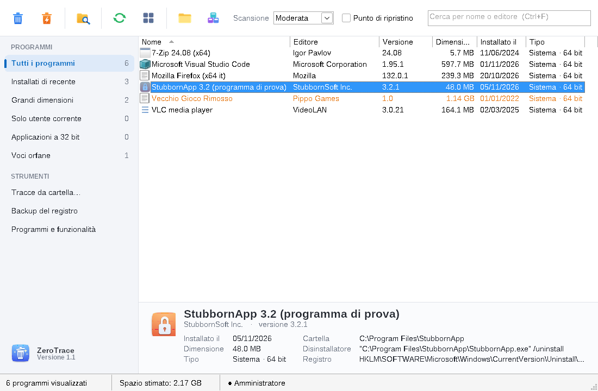
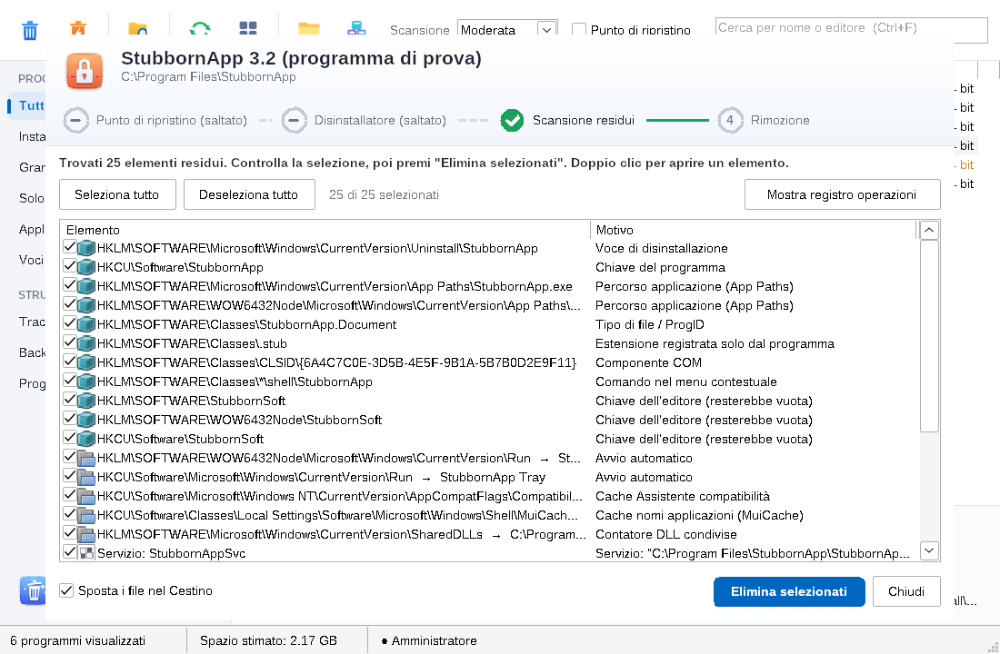
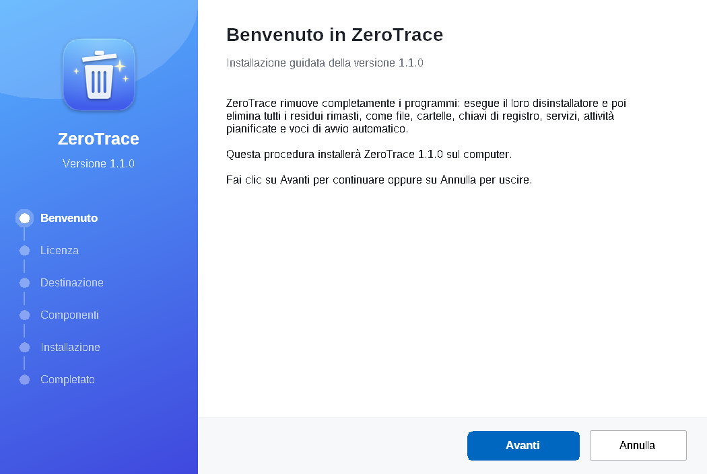

# ZeroTrace — disinstallazione completa stile Revo Uninstaller

Programma Win32 nativo in C++17 (nessun framework, solo API di Windows) che disinstalla un
programma e poi va a caccia di tutto quello che il disinstallatore ha lasciato: file,
cartelle, chiavi e valori di registro, servizi, attività pianificate, avvio automatico,
associazioni file, componenti COM, voci nella variabile PATH, regole del firewall, comandi del
menu contestuale.

> ZeroTrace è il nuovo nome di PurgeIt. L'installer 1.1 rimuove automaticamente PurgeIt 1.0 e
> ne conserva i backup del registro.

## Novità della versione 1.1

- **Interfaccia più compatta** e calcolata sui caratteri reali: niente più etichette tagliate con
  lo schermo ingrandito (125–150%). Barra strumenti su una riga; se la finestra è stretta i
  pulsanti diventano solo icone, con suggerimenti al passaggio del mouse. Colonne adattate alla
  larghezza, finestra iniziale dimensionata sullo schermo.
- **Scansione più completa**: voci aggiunte alla variabile **PATH** (rimosse una per una, senza
  toccare le altre), **regole del firewall** (`netsh`), comandi ed estensioni del **menu
  contestuale**, sovrapposizioni delle icone, estensioni shell approvate, MuiCache, impostazioni di
  compatibilità, cartella temporanea del programma. Un'estensione di file registrata solo dal
  programma viene rimossa per intero; se è condivisa si tolgono solo i valori del programma.
- **Scansione più veloce**: confronto dei percorsi senza allocazioni, buffer riutilizzati, nomi
  normalizzati una volta sola, indice delle chiavi già trovate. Il tempo impiegato è nel registro
  operazioni.



## Interfaccia (stile Revo Uninstaller)

- **Barra strumenti** con icone grandi: Disinstalla, Forza rimozione, Tracce da cartella, Aggiorna,
  Visualizza (righe compatte / righe grandi con icone da 32 px), Apri cartella, Voce di registro.
  I pulsanti che richiedono un programma selezionato si disattivano da soli. A destra: ricerca
  (Ctrl+F), modalità di scansione e opzione punto di ripristino.
- **Barra laterale** con filtri e conteggi: Tutti, Installati di recente (30 giorni), Grandi
  dimensioni (> 500 MB), Solo utente corrente, Applicazioni a 32 bit, **Voci orfane** (il
  disinstallatore non esiste più: mostrate in arancione, si rimuovono con Forza rimozione).
  Sezione Strumenti: tracce da cartella, cartella dei backup del registro, Programmi e funzionalità.
- **Pannello dettagli** del programma selezionato: icona grande, editore, versione, data,
  dimensione, cartella, comando di disinstallazione, chiave di registro.
- **Finestra di rimozione a fasi**: Punto di ripristino → Disinstallatore → Scansione residui →
  Rimozione, con indicatore di avanzamento, residui raggruppati (registro / servizi e attività /
  file e cartelle) con caselle di spunta e contatore, registro operazioni a scomparsa.

Scorciatoie: Invio o doppio clic = disinstalla, Maiusc+Canc = forza rimozione, F5 = aggiorna.

L'icona è in stile macOS Sequoia (squircle a superellisse, gradiente, ombra morbida, glifo bianco
in rilievo); viene generata da `tools/make_icons.py` (Pillow) insieme alle icone della barra strumenti.



## Come funziona

1. **Elenco programmi** — legge `Uninstall` da HKLM 64 bit, HKLM 32 bit (WOW6432Node) e HKCU;
   nasconde componenti di sistema e aggiornamenti. Ricerca, ordinamento per colonna, icone.
2. **(Facoltativo) punto di ripristino** di sistema.
3. **Esecuzione del disinstallatore originale** dentro un *Job Object*: ZeroTrace aspetta la fine
   di **tutti** i processi figli (NSIS/Inno si copiano in `%TEMP%` e rilanciano: un'attesa
   normale finirebbe subito). Per MSI converte `/I{GUID}` in `/X{GUID}`.
   La cartella di installazione viene letta **prima**, perché il disinstallatore cancella la voce.
4. **Scansione residui** in tre modalità:

| Dove guarda | Sicura | Moderata | Avanzata |
|---|:-:|:-:|:-:|
| Voce Uninstall (tutte le viste), `SOFTWARE\<nome>`, `SOFTWARE\<editore>\<nome>` | ✓ | ✓ | ✓ |
| Run / RunOnce / StartupApproved, App Paths, servizi, attività pianificate | ✓ | ✓ | ✓ |
| Variabile PATH (sistema e utente), regole del firewall, comandi del menu contestuale | ✓ | ✓ | ✓ |
| Cartella di installazione, ProgramData, AppData, LocalLow, menu Start, Desktop | ✓ | ✓ | ✓ |
| ProgID / estensioni / OpenWithProgids che puntano al programma | ✓¹ | ✓ | ✓ |
| `SOFTWARE\*\<nome>` e cartelle `*\<nome>` con confronto "fuzzy" | | ✓ | ✓ |
| CLSID e relative estensioni shell (menu contestuale, sovrapposizioni icone, approvate) | | ✓ | ✓ |
| MuiCache, Compatibility Assistant, impostazioni di compatibilità, SharedDLLs, cartella in `%TEMP%` | | ✓ | ✓ |
| Quick Launch / barra applicazioni | | | ✓ |
| Qualsiasi valore in HKCU/HKLM\Software che contiene il percorso (SharedDLLs, Compatibility Assistant, MRU…) | | | ✓ |

¹ solo se la cartella di installazione è nota.

5. **Rimozione** degli elementi spuntati:
   - backup `.reg` di ogni chiave/valore in `C:\ProgramData\ZeroTrace\Backup\<programma>_<data>`;
   - termina i processi ancora in esecuzione dalla cartella del programma;
   - servizi: arresto + `DeleteService`; attività: `schtasks /delete`; firewall: `netsh advfirewall`;
   - PATH: viene tolta solo la voce del programma e Windows viene avvisato del cambiamento;
   - file/cartelle: tolti gli attributi sola lettura/nascosto/sistema, poi Cestino (o eliminazione
     definitiva); se l'**ACL nega l'eliminazione** prende possesso dell'albero
     (`SeTakeOwnership` + `TreeResetNamedSecurityInfo`) e riprova; stessa cosa per le chiavi di registro;
   - file **bloccati**: eliminazione programmata al riavvio (`MoveFileEx` DELAY_UNTIL_REBOOT).

Altre funzioni: **Forza rimozione** (salta il disinstallatore, utile se è rotto o mancante),
**Tracce da cartella…** (per programmi già disinstallati male che non compaiono più in elenco),
menu contestuale con *Apri cartella* / *Apri voce nel Registro*, doppio clic su un residuo per
aprirlo in Esplora file o Regedit.

### Protezioni

Non vengono mai eliminati: radici di unità, `C:\Windows` e tutto il suo contenuto, le cartelle
note di sistema (Programmi, ProgramData, AppData, profilo, Desktop, Menu Start…) né i loro
antenati, sottocartelle `Microsoft`, `WindowsApps`, `Common Files`, `Package Cache`, `Temp`.
Nomi troppo generici ("setup", "tools", "update", "microsoft"…) non vengono usati per la ricerca.
I percorsi sono confrontati per intero (`C:\App` non combacia con `C:\AppData`), junction e link
simbolici non vengono seguiti.

## StubbornApp — il programma di prova "difficile da rimuovere"

`test/StubbornApp` è un programma **innocuo** che simula un software ostinato. Il pulsante
*1. Installa* crea:

- `C:\Program Files\StubbornApp` con file **sola lettura + nascosto + sistema**, plugin in un
  percorso profondo, una cartella `protected\` con **ACL che nega DELETE a Everyone** (anche agli
  amministratori) e `data\session.lock` **tenuto bloccato** da un processo residente (icona
  nell'area di notifica);
- dati in `ProgramData\StubbornSoft`, `AppData\Roaming\StubbornSoft`, `AppData\Local\StubbornApp`;
- collegamenti nel menu Start e sul Desktop pubblico;
- chiavi in HKLM 64 bit, HKLM 32 bit, HKCU (una sottochiave `Licensing` con **ACL che nega DELETE**);
- avvio automatico (HKCU Run e HKLM Run 32 bit), App Paths, estensione `.stub` + ProgID,
  CLSID COM, voce in SharedDLLs e in Compatibility Assistant;
- una voce nella variabile **PATH** di sistema, il comando "Apri con StubbornApp" nel **menu
  contestuale** di tutti i file, una **regola del firewall** e una voce MuiCache;
- un **servizio** (avvio manuale, mai avviato) e un'**attività pianificata** all'accesso
  (esegue `/noop`, che termina subito);
- una voce di disinstallazione con un **disinstallatore difettoso**: si copia in `%TEMP%`, rilancia
  la copia e termina subito; la copia rimuove solo readme, config, collegamento sul desktop e la
  voce Uninstall, poi annuncia "rimosso correttamente".

La finestra mostra in tempo reale quali tracce sono ancora presenti (30 controlli).
*Ripulisci tutto (reset)* rimuove ogni traccia per ripetere il test; da riga di comando:
`StubbornApp.exe /install`, `/purge`, `/status` (codice di uscita = tracce rimaste).

### Procedura di test

1. Avvia `StubbornApp.exe` → **1. Installa** (26/26 tracce presenti).
2. Avvia `ZeroTrace.exe`, seleziona *StubbornApp 3.2 (programma di prova)*, modalità **Avanzata**,
   **Disinstalla**. Conferma la finestra del disinstallatore difettoso.
3. ZeroTrace attende anche la copia in `%TEMP%`, poi mostra i residui. **Elimina selezionati**.
4. Torna su StubbornApp → **Verifica tracce**: devono risultare tutte *rimosse*
   (con modalità Sicura/Moderata restano le 3 tracce marcate *[Avanzata]*).

`selftest.exe C:\percorso\StubbornApp.exe` (console, da amministratore) esegue lo stesso ciclo
in automatico e termina con codice 0 se dopo la rimozione non resta nulla.

> Il disinstallatore difettoso si programma l'auto-eliminazione al riavvio: `%TEMP%\Au_StubbornApp.exe`
> sparisce al primo riavvio.

## Installer

`bin\ZeroTrace-Setup-1.1.exe` è un installer Win32 nativo (nessun NSIS/Inno/MSI), nello stesso stile
dell'applicazione: procedura guidata Benvenuto → Licenza → Destinazione → Componenti →
Installazione → Completato.

- Contiene ZeroTrace, il LEGGIMI e (facoltativo) StubbornApp come risorse incorporate: un solo file.
- Installa in `C:\Program Files\ZeroTrace`, crea il collegamento nel menu Start (e, se scelto, sul
  Desktop) e registra la voce in **App installate** con dimensione, icona e disinstallatore.
- Riconosce una versione già installata e la **aggiorna** nella stessa cartella con le stesse
  opzioni; se ZeroTrace è aperto lo chiude.
- **Disinstallatore** (`uninstall.exe`, avviato da Impostazioni → App o da ZeroTrace stesso): si copia
  in `%TEMP%`, si rilancia, rimuove file, collegamenti e voce di registro, a scelta anche i backup
  in `C:\ProgramData\ZeroTrace`, e infine elimina la propria copia temporanea.
- Modalità silenziosa: `ZeroTrace-Setup-1.1.exe /S [/D=C:\percorso]` e
  `uninstall.exe /uninstall /S` (anche come `QuietUninstallString`).



> Gli eseguibili non sono firmati digitalmente: al primo avvio Windows SmartScreen può mostrare
> l'avviso "Windows ha protetto il PC" (→ *Ulteriori informazioni* → *Esegui comunque*).

## Compilazione

- **Visual Studio**: dal *x64 Native Tools Command Prompt* → `build.bat` (output in `bin\`),
  oppure `cmake -B out -A x64 && cmake --build out --config Release`.
- **MinGW-w64 / MSYS2**: `make` (da MSYS2: `make PREFIX=`).

L'installer va compilato per ultimo, perché incorpora gli altri eseguibili (`build.bat` e `make`
lo fanno già nell'ordine giusto).

I binari pronti (installer incluso) sono nelle **Release** del repository; se compili da te finiscono in `bin\` (MinGW-w64, x64, statici: nessuna DLL esterna richiesta).
ZeroTrace richiede i privilegi di amministratore (manifest `requireAdministrator`); Windows 10/11 x64.

## Struttura

```
src/scanner.h/.cpp     enumerazione, esecuzione disinstallatore, scansione, rimozione forzata
src/main.cpp           interfaccia (barra strumenti, barra laterale, dettagli, finestra a fasi)
src/icons/            icone della barra strumenti
setup/                installer e disinstallatore
tools/make_icons.py    generatore delle icone (python3 + Pillow)
test/StubbornApp/      programma di prova ostinato
test/selftest.cpp      test automatico da console
```
